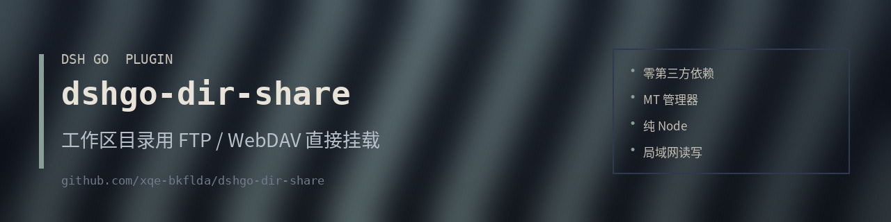

<div align="center">
  
</div>

<p align="right">
  <a href="README_EN.md">English</a> · <b>中文</b>
</p>

<p align="center">
[](https://github.com/xqe-bkflda/dsh-go-market)
  [](LICENSE)
  [](https://github.com/xqe-bkflda/dshgo-dir-share/stargazers)
</p>

### **一行安装**

```bash
curl -fsSL https://raw.githubusercontent.com/xqe-bkflda/dshgo-dir-share/main/install.sh | sh
```

# 目录共享 · DSH Go 插件

把 DSH Go 的工作区目录通过 **FTP** 和 **WebDAV** 转发出来，用 **MT 管理器**（或任何 FTP/WebDAV 客户端）直接挂载读写。

纯 Node 实现，零第三方依赖：自带 FTP 服务端和 WebDAV 服务端，不走电脑、不走局域网的额外软件。

---

## 先装 MT 管理器

这个插件的用途就是给 MT 管理器当网络存储用。没装的先下：

| 渠道 | 地址 |
|---|---|
| 官网 | <https://mt2.cn> |
| 官网直链 APK（v2.26.11，版本号 26110366，38.5 MB） | <https://pan.mt2.cn/apk/26110366> |
| 共存版（包名不同，可与正式版并存） | <https://pan.mt2.cn/apk/26110366/clone> |
| TargetSdk28 版（终端模拟器需要执行权限时用） | <https://pan.mt2.cn/apk/26110366/target28> |
| 应用商店 | 搜 `MT管理器`，包名 `bin.mt.plus` |

要求 Android 5.0+。装完记得给它存储权限，否则挂上去了也读不了。

> 国内直接用官网直链最省事，不用挂梯子；应用商店的版本 targetSdk 是 30，应用数据目录被移除了执行权限。

---

## 装插件

插件目录直接放进 `$DSH_HOME/dsh-go/plugins/`，然后用 dsh 的插件管理装进当前 profile：

```bash
# 1. 放到位（把 <repo> 换成你 clone 下来的目录）
cp -r <repo> "$DSH_HOME/dsh-go/plugins/local-dir-share"

# 2. 装进 profile（本机是 web）
dsh plugin --profile web add "$DSH_HOME/dsh-go/plugins/local-dir-share"

# 3. 重启引擎：App 侧边栏 → 引擎 → 重启引擎
```

装好后在 App 里能找到「目录共享」：

- 对话详情 → **插件** 页签
- **全部功能** → 插件分组
- 输入框上方 **插件** 胶囊 → 弹层

（本插件不上输入框胶囊、不上状态条，只留面板，界面干净。）

---

## 用起来

1. 打开「目录共享」面板 → 点 **启动**
2. 面板上会显示地址、账号、密码，点 **复制地址** 一次全复制
3. MT 管理器 → 左上角菜单 → **网络存储** → **添加网络存储** → **FTP**

填这些：

| 项 | 值 |
|---|---|
| 地址 | `127.0.0.1` |
| 端口 | `2121` |
| 用户名 | `mt` |
| 密码 | 面板上那串（默认随机生成，存在 `~/.dsh/dir-share.json`） |
| 编码 | UTF-8 |
| 匿名 | 不勾 |

同一台手机上用 `127.0.0.1` 就行，**不需要电脑，也不需要同一个 WiFi**。

别的设备（电脑、另一台手机）要挂，就用面板上的「局域网 FTP」那一行，形如 `192.168.x.x:2121`，两台设备在同一 WiFi 下。

---

## 面板功能

| 按钮 | 做什么 |
|---|---|
| 启动 / 停止 | 开关 FTP + WebDAV 监听 |
| 换端口 | 端口被占时自动往后挪（FTP 2121–2199，DAV 8081–8099 回绕） |
| 复制地址 | 复制 FTP 地址 + 账号 + 密码 |
| 复制密码 | 只复制密码 |
| 可读写/只读 | 切只读，客户端写不进来 |
| 换目录 | 在 `工作区` / `手机存储` / `两者` 之间轮换 |
| 刷新 | 立刻刷新面板数据 |

---

## 配置文件

`~/.dsh/dir-share.json`，第一次启动时自动生成：

```json
{
  "mode": "workspace",
  "ftpPort": 2121,
  "davPort": 8081,
  "user": "mt",
  "pass": "<随机生成的 10 位十六进制>",
  "anonymous": false,
  "readOnly": false,
  "autoStart": true
}
```

- `mode`：`workspace`（根 = 工作区）/ `sdcard`（根 = 手机存储）/ `both`（顶层两个虚拟目录 `/workspace`、`/sdcard`）
- `anonymous`：`true` 允许匿名登录（局域网方便，慎用）
- `readOnly`：`true` 时拒绝一切写入
- `autoStart`：引擎起来就自动开监听

改完配置重启引擎生效。

---

## WebDAV

同一份目录也开了 WebDAV，端口 8081：

```bash
# 挂载（Linux）
mount -t davfs http://127.0.0.1:8081/ /mnt/share

# 浏览
curl -u mt:<pass> -X PROPFIND -H "Depth: 1" http://127.0.0.1:8081/
```

浏览器直接打开 `http://127.0.0.1:8081/` 有 HTML 目录页，能点开文件。

---

## 支持的协议

**FTP**：`USER` `PASS` `SYST` `FEAT` `OPTS` `TYPE` `PWD` `CWD` `CDUP` `MKD` `RMD` `DELE` `RNFR` `RNTO` `SIZE` `MDTM` `REST` `PASV` `EPSV` `LIST` `NLST` `MLSD` `MLST` `RETR` `STOR` `APPE` `ABOR` `QUIT`

**WebDAV**：`OPTIONS` `GET` `HEAD` `PUT` `MKCOL` `DELETE` `MOVE` `COPY` `PROPFIND` `PROPPATCH` `LOCK` `UNLOCK`

---

## 安全说明

- **没有 TLS**。FTP 和 WebDAV 都是明文，密码和数据在局域网里可被抓包。
- 默认只监听在你填的端口上，**不要**把 2121 / 8081 暴露到公网。
- 默认账号 `mt` + 随机密码，够局域网自用；要更强的认证自己加反代套 HTTPS。
- 只读模式是给「只看不写」的场景用的，不是安全边界。

---

## 结构

```
package.json         # dshGo 清单：只贡献一个面板，placement 三处齐全
cordis.patch.yml     # bundle 注册
lib/index.js         # 面板视图 / 数据 / 动作，配置读写，端口自增
lib/server.js        # FTP 服务端 + WebDAV 服务端，纯 Node
```

`lib/server.js` 里 `createShare(cfg)` 返回的实例 `running` / `bytes` / `hits` / `log` / `startedAt` 都是 getter，用 `Object.create` + `getOwnPropertyDescriptors` 保住活性——别改成 `{...api}` 展开，会把 getter 当场求值成快照，面板就永远显示「已停止」。

## License

MIT
